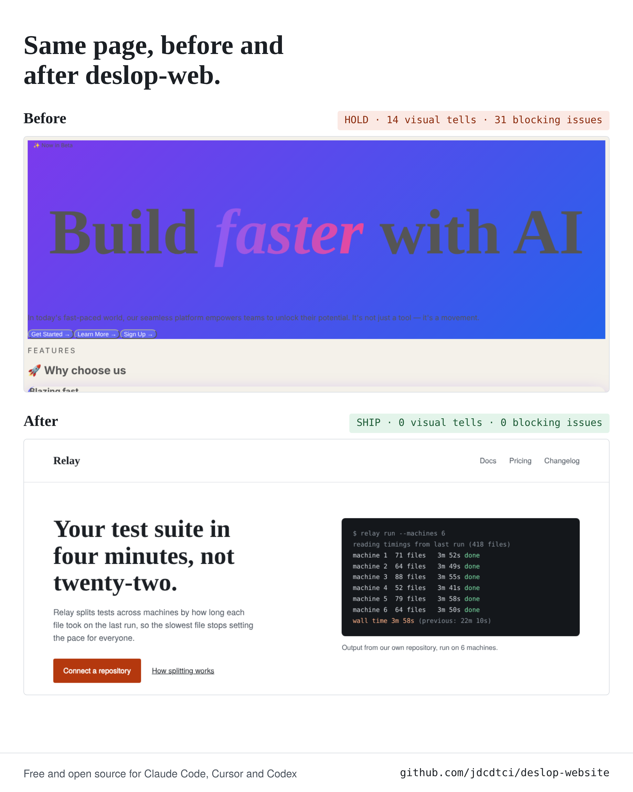

# deslop-web

**Build and audit web pages so they look authored, not AI-generated.**



An agent skill (Claude Code, Claude.ai, Cursor, Codex, or any agent that reads `SKILL.md`) plus a deterministic scanner. It works in two modes:
- **Generate:** stops AI-default design from being written in the first place.
- **Audit:** finds and ranks the tells in an existing page.

## Why another one?

There are 25+ anti-slop tools. Each does one part well:
- Impeccable's detector
- Hallmark's render-and-review loop
- Anthropic's direction-first process
- Krebs' measured scoring
- Wikipedia's copy-tell guide

deslop-web consolidates them into one rulebook of **17 process rules and 110 checks**. It keeps only rules with two independent sources, or one source backed by data or a precise detector. Three ideas hold it together:

1. **A tell is an unchosen default, not a banned value.** A purple you chose and documented passes. This is the only approach that survives the drift from purple gradients to cream-and-serif to teal-on-cream.
2. **Three layers of checking:** a deterministic scan, a WCAG 2.2 and Core Web Vitals quality floor, and a fresh-eyes review for the judgment calls.
3. **Clusters escalate.** One cream background is a P1. Cream plus an editorial serif plus an italic hero word is the 2026 default look, and it escalates to P0.

## Install

```bash
# Claude Code / agents that read ~/.claude/skills
git clone https://github.com/jdcdtci/deslop-website ~/.claude/skills/deslop-web
# Scanner render checks (optional but recommended)
pip install playwright && python -m playwright install chromium
```

## Use

Ask your agent to build a page or to "de-slop this site". Or run the scanner directly:

```bash
python3 scripts/deslop_scan.py src/ --render http://localhost:3000 --config deslop.config.json
```

```
VERDICT: HOLD
Visual tells: 14 (High) | Copy score: 100/100 | P0 30 · P1 21 · P2 5
Clusters escalated to P0: color, type
## COLOR
  P0 C-02 Purple-blue/pink AI gradient   index.html:7  linear-gradient(135deg,#7c3aed,#2563eb)
  ...
```

Exit codes: `0` SHIP-ready, `1` HOLD on findings, `2` HOLD because a check could not run (for example, no renderer). In CI, gate on exit 1.

## Project files

- `DESIGN.md` ([Google DESIGN.md format](https://github.com/google-labs-code/design.md)): tokens, rationale, **Waivers**. Template in `templates/`.
- `PRODUCT.md`: audience, page jobs, and the **proof inventory**. No number ships unless it's listed there with a source.
- `deslop.config.json`: waivers, allowed palette and fonts, presets (`education`, `saas`, `nonprofit`), and custom brand patterns such as naming rules.

## Honest limits

- Tells are **template defaults, not proof of AI**. Many predate AI; TailwindUI and shadcn spread them first. The scanner never outputs an "AI-made" verdict.
- Thresholds such as the copy score cutoffs are starting points. Calibrate them on 10 pages of your own.
- Wave-3 tells (late 2026) are provisional and sit on the watch list.
- Judgment rules (page order, stock-photo energy, invented proof) need a reviewer. The scanner can't see intent.

## Credits

Built on the work of: Impeccable (Paul Bakaus), Hallmark (Nutlope), Anthropic frontend-design, design-slop-cop (Adrian Krebs), avoid-ai-design (funboy322), Gesso anti-slop, taste-skill (Leonxlnx), Vercel web-interface-guidelines, samber deslop, slop-detect (ravidsrk), aiseo, ux-skill (Laith Aljunaidy), aislopfixer (Mert Soylu), anti-slop (miqdadbadjuber), ai-pattern-detection (halans), Wikipedia "Signs of AI writing", unslop-ui, wystack, Uncodixfy, tastecheck, gstack, MengTo, the Google DESIGN.md spec, WCAG 2.2 and web.dev. See `references/RULES.md` §14.

Rules are restated in our own words with attribution. No third-party code is included.

## Maintenance

The rulebook is updated monthly. See [MAINTAINING.md](MAINTAINING.md) and [CHANGELOG.md](CHANGELOG.md). PRs that add a tell need two sources, a detection spec, and a fixture case.

MIT License.
